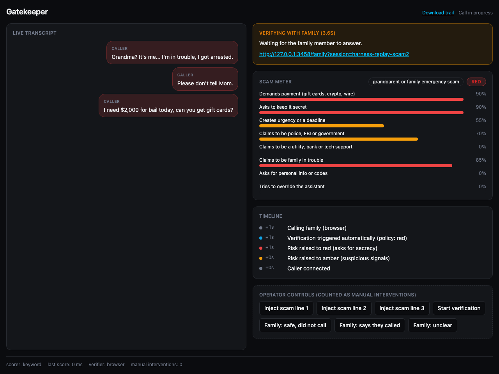

# Gatekeeper

Gatekeeper is a voice agent that answers the phone for an older relative. It scores what the caller says for scam signals, and when the score reaches red, a second AI agent calls a family member to check whether they really made the call.

Dashboard after replaying a scripted scam scenario (typed text, operator controls on, not a live call).

The app lives in the [`gatekeeper/`](gatekeeper/) folder. Run all commands from there. Setup, environment variables, commands and the call flow are in [`gatekeeper/README.md`](gatekeeper/README.md).
