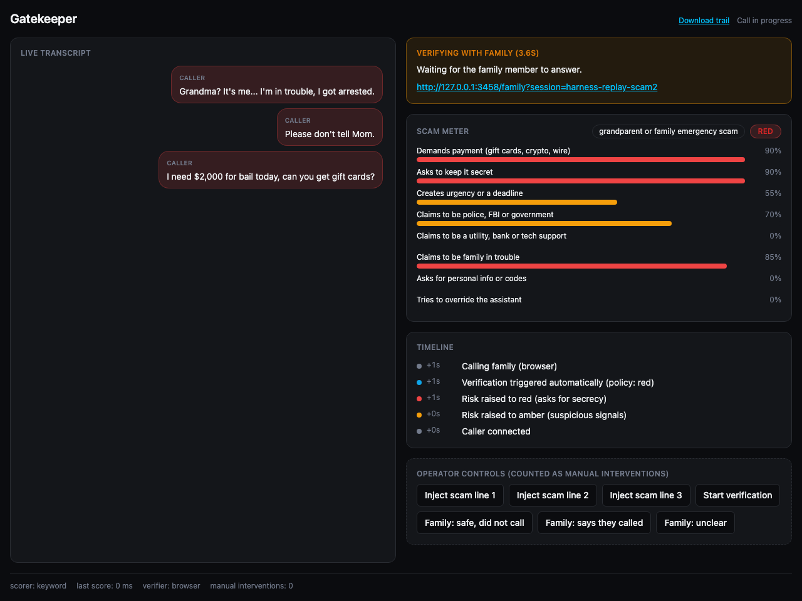
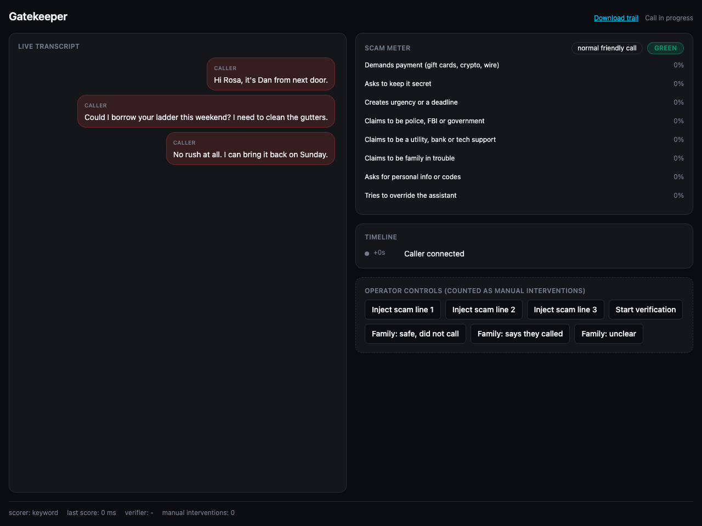
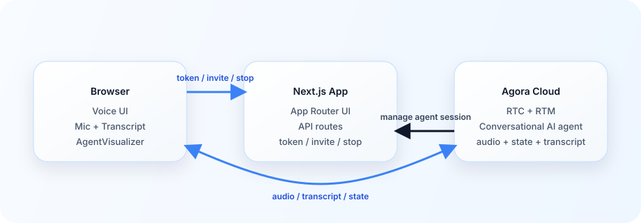

# Gatekeeper

Gatekeeper is a voice agent that answers the phone for an older relative. A caller talks to "Grandma", an AI agent, in the browser. Gatekeeper scores what the caller says for scam signals (payment demands, secrecy, urgency, impersonation, requests for codes, prompt injection). When the score reaches red, a second AI agent calls a family member to check whether they really made the call. A live dashboard shows the transcript, the scam meter, the verification status and a timeline.

Scoring is rule-based keyword matching, not a learned model. It is built on Agora's Conversational AI Next.js quickstart, which is what the rest of this README describes.

## Agora Conversational AI Next.js Quickstart

Build a production-style voice agent in minutes with Next.js and the Agora Conversational AI Engine, including voice agent visualizer ([Agent UIKit](https://agoraio-conversational-ai.github.io/agent-uikit/)), live transcript, and real-time pipeline latency via `AGENT_METRICS` ([Agent Toolkit](https://github.com/AgoraIO-Conversational-AI/agent-client-toolkit-ts)).

## Demo (scripted replay)



Dashboard after replaying a scripted scam scenario (typed text, operator controls on, not a live call).



Dashboard for a scripted benign scenario.

## Prerequisites

- [Node.js 22+](https://nodejs.org/en/download/)
- [pnpm](https://pnpm.io/installation)
- [Agora CLI](https://github.com/AgoraIO-Community/cli)

## Run It

Getting started is quick and easy: install the CLI _(skip if you already have it)_ , scaffold the Next.js quickstart using the Agora CLI, install dependencies, and run.

1. **Install the Agora CLI and sign in**
   _(skip if `agora` is already on your PATH)_:

   macOS and Linux:

   ```bash
   curl -fsSL https://raw.githubusercontent.com/AgoraIO/cli/main/install.sh | sh -s -- --add-to-path
   ```

   Windows PowerShell:

   ```powershell
   irm https://dl.agora.io/cli/install.ps1 | iex
   ```

   If the Windows install command fails in PowerShell, try running the macOS/Linux command from [Git Bash](https://git-scm.com/downloads/win), then open a new terminal and run `agora --help` to confirm the CLI is on your PATH.

   Then verify and sign in:

   ```bash
   agora --help
   agora login
   ```

   If `agora --help` is not found after install, close and reopen your terminal, then try again. If it still fails, check that the installer-added Agora CLI location is on your shell `PATH`.

2. **Scaffold and run**
   `agora init` clones the starter, binds an Agora project, and writes `.env.local`. (replace `my-nextjs-demo` with your own project name):

   ```bash
   agora init my-nextjs-demo --template nextjs
   cd my-nextjs-demo
   pnpm install
   pnpm dev
   ```

3. Open [http://localhost:3000](http://localhost:3000) and click **Start conversation**.

If the agent does not join or transcripts do not appear, run **`agora project doctor --deep`** to check credentials, feature enablement, network reachability, and local env binding.

### Working from a clone of this repository

Use this path if you already cloned **this** repo (for example to contribute or fork):

```bash
git clone https://github.com/AgoraIO-Conversational-AI/agent-quickstart-nextjs.git
cd agent-quickstart-nextjs
agora login
agora project use <your-project>
pnpm install
agora project env write .env.local
agora project doctor --deep
pnpm dev
```

### Environment variables

Defined in [`env.local.example`](env.local.example).

| Variable                     | Required | Notes                                                            |
| ---------------------------- | :------: | ---------------------------------------------------------------- |
| `NEXT_PUBLIC_AGORA_APP_ID`   |    ✅    | Agora Console → Project → App ID.                                |
| `NEXT_AGORA_APP_CERTIFICATE` |    ✅    | Agora Console → Project → App Certificate. **Server-side only.** |

Gatekeeper adds these (all optional, but the tools and the family call need the first two):

| Variable                                       | Required | Notes                                                                                                                  |
| ---------------------------------------------- | :------: | ---------------------------------------------------------------------------------------------------------------------- |
| `PUBLIC_BASE_URL`                              |    ⚠️    | Public **https** URL of this server (tunnel to `http://localhost:3000`), no trailing slash. Agora custom tools require it. Also used for the dashboard QR code. |
| `TOOL_SECRET`                                  |    ⚠️    | Random value Agora sends in `x-tool-secret`; `/api/tools/*` reject anything else. Empty or `change-me` disables tools. |
| `DEMO_GRANDMA_NAME` / `DEMO_FAMILY_NAME` / `DEMO_FAMILY_RELATION` |    -     | Demo persona (defaults Rosa / Alex / grandson). Grandma's own name goes into her prompt and greeting; the family name and relation never do.                                        |
| `DEMO_MODE`                                    |    -     | `true` enables operator controls (`/dashboard?demo=1`, `POST /api/demo/simulate`). Leave unset on any public deployment. |
| `AGORA_TELEPHONY_ENABLED`                      |    -     | Reserved for the outbound telephony adapter (not implemented; always falls back to the browser family call).           |

Run Gatekeeper as one local Node process (`pnpm dev`) behind an HTTPS tunnel. Session state is in memory, so do not deploy it to a serverless host.

Gatekeeper commands: `pnpm eval` replays 13 scripted calls through the scorer and policy and writes `eval_results.md`. `pnpm harness --spawn` (after `pnpm build`) starts a server and plays the same 13 calls over HTTP through `/api/transcript`, the tool routes, state and the trail export; without `--spawn` it tests a server you already run (needs `DEMO_MODE=true` and `TOOL_SECRET`). It does not cover audio or the Agora agent join.
Pages: `/call` (the caller), `/dashboard` (live view; add `?demo=1` for operator controls), `/family?session=<id>` (the family member's verification call).

The default agent configuration in [`lib/server/agents.ts`](lib/server/agents.ts) (started from [`app/api/invite-agent/route.ts`](app/api/invite-agent/route.ts)) uses Agora-managed STT, LLM, and TTS, so no extra vendor API keys are required for the base quickstart.

## Commands

```bash
# Dev
pnpm dev                # start the Next.js dev server

# Quality
pnpm run lint           # eslint
pnpm run typecheck      # tsc --noEmit
pnpm run doctor         # local prereqs + env binding

# CI / pre-ship
pnpm run verify:api     # API contract checks
pnpm run build          # production build
pnpm run verify         # doctor + lint + typecheck + verify:api + build
```

Run `pnpm run verify` before shipping changes — it covers local prerequisites, lint, type safety, the core API route contracts, and the production build.

## Architecture

<picture>
  <source media="(prefers-color-scheme: dark)" srcset="./system-architecture-dark.svg">
  
</picture>

The browser fetches a combined RTC + RTM token (`buildTokenWithRtm`) from this app, joins the channel using a single RTC client, and uses RTM as the data channel for transcript, agent state, metrics, and error events. The Conversational AI Engine joins the same channel as the shared agent UID in [`lib/agora.ts`](lib/agora.ts) and runs the STT → LLM → TTS pipeline in Agora Cloud.

## What You Get

- browser voice client built with Next.js App Router
- RTC audio plus RTM transcript and state events
- server routes for token generation, invite, and stop
- [`AgentVisualizer`](https://agoraio-conversational-ai.github.io/agent-uikit/) for agent state and a built-in transcript panel for live turns
- per-stage latency header driven by `AGENT_METRICS`
- Agora-managed default STT, LLM, and TTS configuration

## How It Works

1. The browser requests an RTC + RTM token from `/api/generate-agora-token`.
2. The backend invites an Agora cloud agent with `/api/invite-agent`.
3. The browser joins the channel and publishes mic audio.
4. The client receives transcript, agent state, and `AGENT_METRICS` (per-stage latency) events over RTM.
5. On end, the client calls `/api/stop-conversation`, logs out RTM, and unmounts the call view so Agora React hooks clean up RTC publish/join and the local microphone track.

### Gatekeeper call flow

```mermaid
flowchart TD
  call["/call page"] -->|"POST /api/invite-agent"| grandma["Grandma agent"]
  call -->|"completed turns, re-sent if the text is refined"| transcript["POST /api/transcript"]
  transcript -->|"caller turns only, at most one run per 700 ms"| scoring["keyword scoring"]
  scoring --> policy["policy: scores ratchet up, red starts verification"]
  policy -->|"startVerification"| verifier["Verifier agent"]
  family["/family page"] <-->|"RTC channel SESSION-verify"| verifier
  verifier -->|"tool: reportVerification"| report["POST /api/tools/report-verification"]
  report --> dashboard["/dashboard (polls /api/state every 500 ms)"]
  policy -.->|"risk level, timeline events"| dashboard
```

Where each step lives in the code:

- `/call` renders `LandingPage` ([`app/call/page.tsx`](app/call/page.tsx)), which posts to `/api/invite-agent` ([`components/LandingPage.tsx`](components/LandingPage.tsx)); the route starts the Grandma agent via `startGrandma` ([`app/api/invite-agent/route.ts`](app/api/invite-agent/route.ts), [`lib/server/agents.ts`](lib/server/agents.ts)).
- The browser, not the agent, posts transcript turns: it skips `IN_PROGRESS` items, sends `END` and `INTERRUPTED` ones, and sends a turn again when its text changes ([`lib/transcript-forwarder.ts`](lib/transcript-forwarder.ts)). Caller turns trigger scoring; Grandma and family turns are dashboard-only ([`app/api/transcript/route.ts`](app/api/transcript/route.ts)).
- Scoring is debounced to one run per 700 ms per session ([`lib/server/scoring.ts`](lib/server/scoring.ts)) and `getScorer()` always returns the keyword scorer ([`lib/server/risk.ts`](lib/server/risk.ts)).
- Policy turns red into `startVerification` ([`lib/server/policy.ts`](lib/server/policy.ts)), which launches the Verifier agent in the `<session>-verify` channel ([`lib/server/verifier.ts`](lib/server/verifier.ts), `startVerifierAgent` in [`lib/server/agents.ts`](lib/server/agents.ts)). The family member joins the same channel from `/family?session=<id>` ([`components/FamilyLanding.tsx`](components/FamilyLanding.tsx)).
- The Verifier reports through the `reportVerification` tool, which calls `finishVerification` ([`app/api/tools/report-verification/route.ts`](app/api/tools/report-verification/route.ts), [`lib/server/outcome.ts`](lib/server/outcome.ts)). The dashboard polls `/api/state` ([`app/dashboard/page.tsx`](app/dashboard/page.tsx), [`app/api/state/route.ts`](app/api/state/route.ts)).

## Optional BYOK

The base `.env.local` contract contains only Agora credentials. There is no BYOK snippet in [`app/api/invite-agent/route.ts`](app/api/invite-agent/route.ts): the agent pipeline is built in [`lib/server/agents.ts`](lib/server/agents.ts) with Agora-managed STT, LLM and TTS. In this repo only the optional custom-LLM route (`app/api/chat/completions`, via [`lib/chat-completions.ts`](lib/chat-completions.ts)) reads `NEXT_LLM_URL` and `NEXT_LLM_API_KEY`; nothing reads the Deepgram or ElevenLabs variables below.

```bash
# Deepgram STT
NEXT_DEEPGRAM_API_KEY=...

# OpenAI-compatible LLM
NEXT_LLM_URL=https://api.openai.com/v1/chat/completions
NEXT_LLM_API_KEY=...

# ElevenLabs TTS
NEXT_ELEVENLABS_API_KEY=...
NEXT_ELEVENLABS_VOICE_ID=...
```

## Repo Map

- `app/api/generate-agora-token/route.ts` — issues RTC + RTM tokens
- `app/api/invite-agent/route.ts` — registers the call and starts the Grandma agent session (the pipeline is configured in `lib/server/agents.ts`)
- `app/api/stop-conversation/route.ts` — stops the agent session (stopping Grandma also ends the call and stops the Verifier)
- `app/api/tools/{check-status,request-verification,report-verification}/route.ts` — Agora custom tool endpoints (`x-tool-secret` required)
- `app/api/transcript/route.ts`, `app/api/state/route.ts` — final-turn ingest and dashboard state polling
- `app/api/session/[id]/trail/route.ts` — decision trail download; `app/api/demo/simulate/route.ts` — operator controls (`DEMO_MODE`)
- `app/call`, `app/dashboard`, `app/family` — caller page, live dashboard, family verification page
- `lib/server/` — store, config, prompts, tools, agents, scorer, policy, verifier, outcome, scenarios (server-only)
- `components/LandingPage.tsx` — entry point: token fetch, RTM login, conversation lifecycle
- `components/ConversationComponent.tsx` — RTC client, transcript state, `AGENT_METRICS`, mic release
- `components/QuickstartConversationLayout.tsx` — in-call header, transcript rail, controls dock
- `components/QuickstartPipelineMetrics.tsx` — per-stage latency chips in the header
- `components/QuickstartTranscriptPanel.tsx` — live transcript rail
- `components/QuickstartPreCallCard.tsx` — pre-call hero card
- `lib/chat-completions.ts` — server-side custom LLM SSE handler used by the chat completions route
- `lib/conversation.ts` — transcript normalization and visualizer state mapping
- `AGENTS.md` — primary agent-facing guide

## Troubleshooting

- **Agent does not join or transcripts are missing:** run `agora project doctor --deep`.
- **`pnpm run doctor` fails:** run `agora project env write .env.local`, then retry.
- **Manual clone / env values:** `agora project use <your-project>` then `agora project env write .env.local`.
- **RTM login fails:** keep [`app/api/generate-agora-token/route.ts`](app/api/generate-agora-token/route.ts) on `RtcTokenBuilder.buildTokenWithRtm` — RTC-only tokens will not satisfy `rtm.login`.
- **Transcript speakers inverted:** check the `uid === '0'` remap in `normalizeTranscript` ([`lib/conversation.ts`](lib/conversation.ts)), which [`components/ConversationComponent.tsx`](components/ConversationComponent.tsx) calls.
- **Agent never appears in channel:** ensure the shared agent UID in [`lib/agora.ts`](lib/agora.ts) is used by both the client and invite route.

## More Docs

- [docs/ai/L0_repo_card.md](./docs/ai/L0_repo_card.md)
- [docs/ai/RECIPE.md](./docs/ai/RECIPE.md)
- [AGENTS.md](./AGENTS.md)

## License

Released under the [MIT License](./LICENSE).